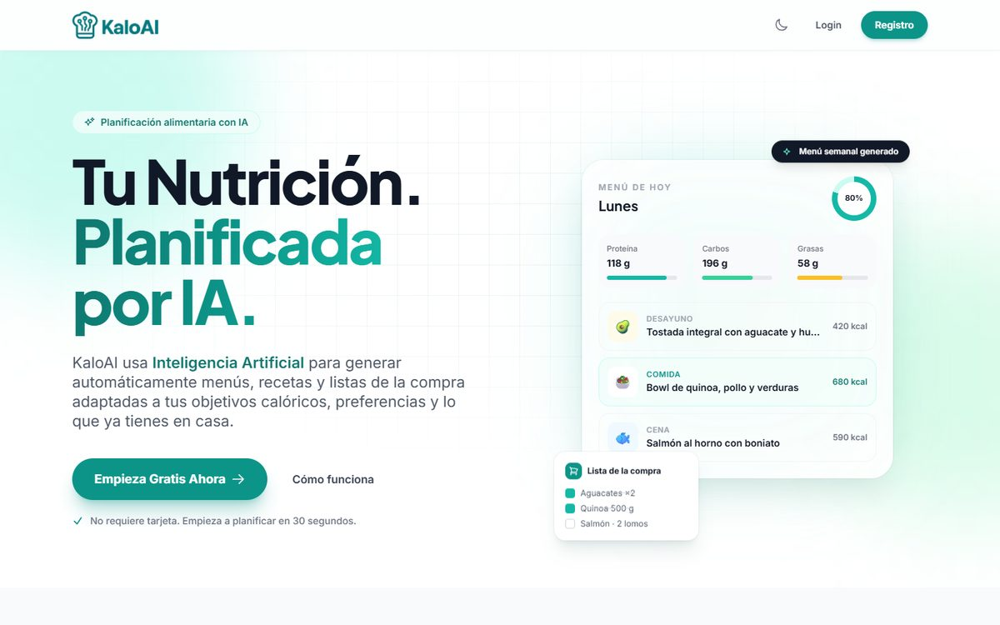
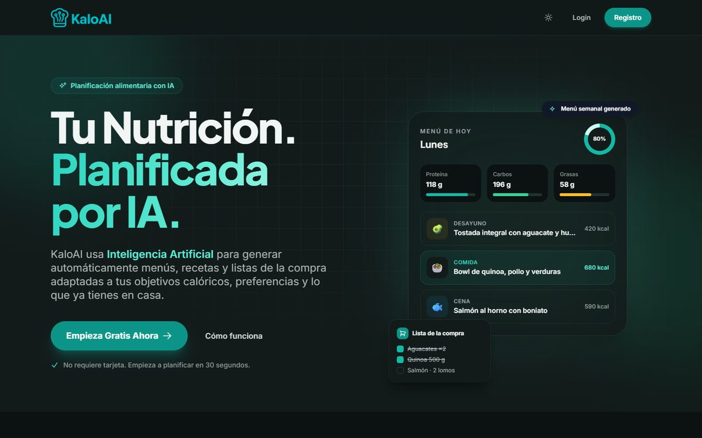

# KaloAI

Plataforma de nutrición con recetas generadas por IA según las calorías, los objetivos y las intolerancias de cada persona. Incluye plan semanal, inventario con lista de la compra y tres roles: usuario, nutricionista y administración.

**Demo:** [kaloai.infinityfreeapp.com](https://kaloai.infinityfreeapp.com/?i=1) · La interfaz está en español.

| Modo claro | Modo oscuro |
| --- | --- |
|  |  |

## Qué hace

- **Recetas con IA:** Google Gemini genera recetas a partir del perfil (calorías, macros, alergias e intolerancias) y de lo que hay en el inventario. Si una clave de API llega a su límite, la petición pasa a la siguiente.
- **Plan semanal, inventario y lista de la compra:** la lista se descarga en PDF (Dompdf).
- **Progreso:** gráficos de peso y macros con Chart.js.
- **Roles:** el nutricionista vincula pacientes y puede gestionar su cuenta en un modo aparte, con una barra que lo indica; el administrador gestiona usuarios.
- **Modo claro y oscuro:** sigue el tema del sistema o el que elijas con el botón de la cabecera, y lo recuerda.

## Cómo está hecho

- **PHP 8 sin framework**, con la lógica en `core/` y las vistas en `views/` (por rol: `user`, `nutri`, `admin`, `auth`).
- **MySQL con PDO** y sentencias preparadas reales; contraseñas con `password_hash` / `password_verify`.
- **Tailwind CSS** (CDN) y JavaScript sin dependencias para la interfaz.
- **Modo oscuro** en `public/css/oscuro.css`: da su versión oscura a las clases de Tailwind que usa la web, sin repetir variantes en cada vista.

```
core/        conexión, utilidades, llamadas a Gemini y guardado de recetas
views/       páginas por rol y plantillas comunes (cabecera, pie, tema)
public/      CSS, JavaScript, contacto y privacidad
images/      logotipo y vista previa para redes
```

## Ponerlo en marcha en local

1. Clona el repositorio e instala las dependencias: `composer install`.
2. Copia `core/configuracion-example.php` como `core/configuracion.php` y pon tus datos de MySQL y tus claves de la API de Gemini. Ese archivo no se sube al repositorio.
3. Arranca un servidor PHP en la carpeta del proyecto: `php -S localhost:8000`. La URL base se ajusta sola en local, también si el proyecto está en una subcarpeta de XAMPP.

El esquema de la base de datos aún no está publicado en el repositorio.

---

Hecho por [Félix Corcoran](https://dev.felixcorcoran.es) · desarrollador full stack e integración de IA.
